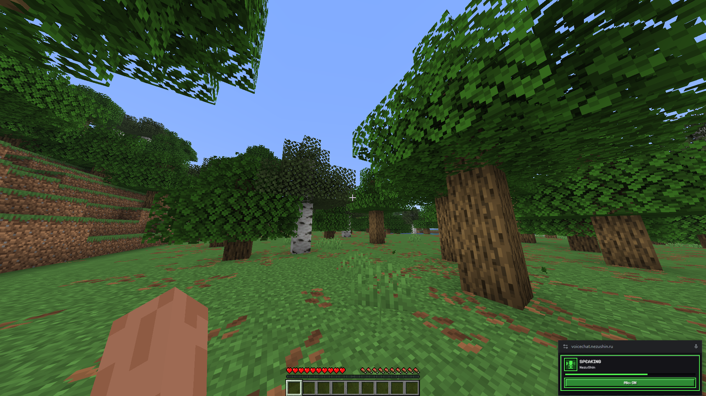
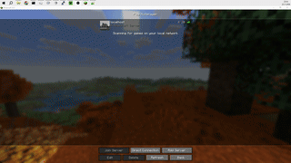

# Voice web bridge

**Plug-and-play proximity voice chat for everyone on your Minecraft server — voice chat available in 3 clicks for players.**

### Features

- Bridge between web, plasmo and SVC players
- Web-based voicechat for vanilla and bedrock players
- Configurable overlay in web
- Voice chat available in 3 clicks for players
- Plug-n-play for small servers and play with friends - **without additional ports forwarding, webserver and ssl configuration**
- Fully self-hostable for advanced setups and big servers - **no limits, max webpage configurability**
- Always free and open source under GPL-3 license

### Supported server platforms
- [Papermc](https://papermc.io/software/paper/)
- [Folia](https://papermc.io/software/folia/)
- [Spigot](https://www.spigotmc.org/)

### Showcase

### Installation

- Install [Simple Voice Chat](https://modrinth.com/plugin/simple-voice-chat)
- Install [Plasmo Voice](https://modrinth.com/plugin/plasmo-voice)
- Install latest release from [releases](https://github.com/NezuShin/voice-web-bridge/releases)

### Self-hosted webpage configuration

In this mode plugin works different way - it serves websocket server itself. Nginx needed here only for ssl proxy and webpage hosting. Example config is [available here](https://github.com/NezuShin/voice-web-bridge/blob/main/webpage/nginx.conf.example). Nothing will work without SSL - modern browsers want encryption to use microphone on page. And mix of http/ws and https is also prohibited.

### Permissions

- `voicebridge.admin` - access to `/voicewebbridge` admin commands
- Player command `/mic` does not require any permission

### Admin commands

Aliases: `/vb`, `/voicewebbridge`, `/vwb`

- `/voicebridge` - show command help
- `/voicebridge status` - show bridge status, SVC/PV readiness, web transport state, and metrics
- `/voicebridge players` - list active voice sessions (`[SVC]`, `[PV]`, `[SVC+PV]`, `[WEB]`)
- `/voicebridge reload` - reload `config.yml` (restarts web transport if web settings changed)
- `/voicebridge debug [on|off]` - toggle debug logging

### User commands

- `/mic` - toggle your browser voice microphone On/Off, or resend your personal voice chat link if not connected yet

###  Looking for affordable and powerful Server hosting?

Make sure to check out [GaleniusNodes](https://billing.galeniusnodes.com/ref/nmap)! Starting at 3€/month.\
[With my link you can get 20% off Your first month](https://billing.galeniusnodes.com/ref/nmap)

### Help and support

If you have questions, want ask for a feature or report a bug - feel free to [open issue](https://github.com/NezuShin/voice-web-bridge/issues),\
Also you can ask a question in the [discord server](https://discord.gg/rZ7gfCTr3Y).

### Known limitations

- Proximity voice chat only (group/channel bridging is not yet supported)
- Transcoding mode is not yet implemented (Opus passthrough only)
- SVC-only players may not receive audio from PV players in some edge cases

### License

Voice Web Bridge is distributed under the **GNU General Public License v3.0** ([LICENSE](LICENSE)) with an additional permission under GPLv3 Section 7 allowing linking and combining with Simple Voice Chat, Minecraft, and Minecraft server platforms ([LICENSE-EXCEPTION](LICENSE-EXCEPTION)).

Copyright (c) 2026 nezushin. Based on [Voice Bridge](https://github.com/PfauMC/voice-bridge) — Copyright (c) 2026 PfauMC, originally licensed under the MIT License.

All preserved upstream and third-party notices (PfauMC, bStats, Java-WebSocket, SLF4J, `opus-recorder` / Opus / Speex, and the `Pixelify Sans` SIL OFL 1.1 font) — along with GPLv3 Section 6 Corresponding Source details for release distributions — are documented in [THIRD_PARTY_LICENSES.md](THIRD_PARTY_LICENSES.md).